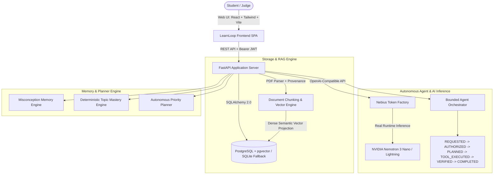

# LearnLoop AI — Autonomous, Privacy-Aware Personal Learning Agent

**Database setup:** see [backend/DATABASE.md](backend/DATABASE.md) for PostgreSQL,
Supabase storage, migrations and production limitations. Run `python -m alembic
upgrade head` before starting the backend; demo data is now explicitly opt-in.

> **Upload what you study. LearnLoop learns what you need. Every study session produces the next best action.**
> 
> *Built for the NVIDIA & Nebius AI Hackathon 2026.*

[](LICENSE)
[](https://python.org)
[](https://fastapi.tiangolo.com)
[](https://vitejs.dev)
[](https://tokenfactory.nebius.com)

---

## 1. Problem Statement & The Core Innovation

College and university students face scattered resources: lecture slides, PDFs, syllabi, assignments, and examination deadlines. While conventional AI chatbots answer isolated questions, they suffer from three fatal flaws:
1. **Zero Learner Memory**: They do not remember what a student misunderstood across study sessions.
2. **Unverified Claims**: They claim mastery based on student claims rather than objective assessment evidence.
3. **Static Planning**: They cannot autonomously recalculate what the student needs to review next based on observed diagnostic errors.

### The Defining Innovation: **Misconception Memory**
LearnLoop AI introduces **Misconception Memory**. Instead of merely tallying test scores, the agent tracks:
- What conceptual error was committed.
- The concrete evidence from assessment answers.
- The targeted remediation or counter-example attempted.
- Strict resolution rule: **A misconception is marked resolved ONLY upon a verifiable, correct follow-up assessment targeted at that exact concept.**

### Audio Innovation: **KEVIN Voice AI Tutor**
To transform studying into an interactive, hands-free experience:
- **Audio In / Audio Out**: Takes real-time voice input from the student's microphone and replies in audio via speech synthesis with articulate KEVIN cadence.
- **Persistent Audio Session History**: Just like ChatGPT stores past text chats, LearnLoop stores past conversations in **audio format** with playable audio tracks, transcripts, and grounded course document citations.
- **Arc Reactor HUD**: Features an interactive glowing Arc Reactor voice controller that pulses visually during listening and voice synthesis.


---

## 2. Architecture



### Deterministic Priority Formula
The autonomous study planner ranks topics dynamically:
$$\text{Priority} = 0.35 \times (1 - \text{Mastery}) + 0.25 \times \text{Exam Urgency} + 0.20 \times \text{Forgetting Risk} + 0.20 \times \text{Prerequisite Impact}$$
- Staggered and recalculates immediately upon assessment events.
- Emits explicit reason codes: `LOW_MASTERY`, `RECENT_ERROR`, `EXAM_URGENCY`, `REVISION_DUE`, `PREREQUISITE_GAP`.

---

## 3. The Hackathon Demonstration Scenario (Reproducible Flow)

A pre-seeded demonstration course, **Machine Learning Fundamentals (CS-401)**, is included out of the box with the exact **Accuracy vs. Recall Paradox** scenario:

1. **Instant Access**: Click **"Judge Instant Demo"** on the landing page or `/v1/auth/demo-login` (User: `demo@learnloop.ai`).
2. **Course & Materials**: Open `Machine Learning Fundamentals`. Inspect `Lecture 4: Evaluation of Classification Models in Imbalanced Domains`.
3. **Grounded AI Tutor**: Ask *"What is the accuracy paradox and why is accuracy misleading in imbalanced datasets?"*
   - Returns evidence-backed explanation citing `lecture_4_metrics_imbalanced.txt (Page 2)` with expandable excerpts.
4. **Diagnostic Quiz**: Navigate to `Quizzes & Diagnostics` and start the assessment.
5. **Intentional Misconception**:
   - Question: *"A model achieves 98% accuracy on a fraud detection dataset where 99% of samples are legitimate. Does this model necessarily have high recall for fraud cases?"*
   - Select: *"Yes, 98% accuracy guarantees high recall across all classes."* (or click *"Simulate Hackathon Judge Error"*).
6. **Instant Assessment Scored**:
   - Backend deterministically flags answer as incorrect.
   - Explains the counter-example (predicting all negative gives 99% accuracy but 0% recall).
   - Topic mastery for *Precision, Recall & Imbalanced Classes* decreases.
7. **Misconception Recorded**:
   - Navigate to `Learning Memory`.
   - Inspect the open gap: `Belief that high overall accuracy guarantees high recall for minority classes in imbalanced datasets`.
   - Status transitions to `NEEDS_RETEST`.
8. **Study Planner Recalculated**:
   - Open `Study Planner`. The topic has been automatically boosted to Rank #1 with trigger codes `RECENT_ERROR` and `LOW_MASTERY`.
9. **Cross-Session Persistence**: Log out and log back in. The memory and prioritized plan remain intact.
10. **Targeted Re-Test & Resolution**:
    - Take another quiz question targeting this gap: *"Suppose a cancer screening test has 95% overall accuracy on a population where only 1% has cancer. If the model fails to detect any actual cancer cases, what is its recall for cancer?"*
    - Select: `0%`.
    - Submit. The status of the misconception in `Learning Memory` transitions to **RESOLVED**!
11. **Agent Audit Trail**: View `Agent Activity` to inspect the full timeline and tool logs.
12. **Student Privacy**: Go to `Settings & Privacy` to inspect disclosures, export JSON memory, or purge learning records.

---

## 4. Quickstart Guide

### Prerequisites
- Python 3.11+
- Node.js 18+ and npm

### Local Development (Zero Docker Required)

#### 1. Setup Backend
```bash
# Clone the repository
git clone https://github.com/ang21506/NVIDIA_X_NEBIUS.git
cd NVIDIA_X_NEBIUS

# Create and activate Python 3.11 virtual environment
python -m venv venv
# Windows:
.\venv\Scripts\activate
# Linux/macOS:
source venv/bin/activate

# Install dependencies
pip install -r backend/requirements.txt

# Configure environment variables (optional for live Nemotron inference)
cp .env.example .env
# Edit .env and paste your NEBIUS_API_KEY if testing live Nebius inference

# Start FastAPI backend
uvicorn backend.app.main:app --reload --port 8000
```
Backend API will be running at `http://localhost:8000` with interactive Swagger docs at `http://localhost:8000/docs`.

#### 2. Setup Frontend
```bash
cd frontend

# Install dependencies
npm install

# Start development server
npm run dev
```
Open `http://localhost:5173` in your browser.

---

### Running with Docker Compose (PostgreSQL + pgvector)

```bash
# Set your Nebius API key in environment
export NEBIUS_API_KEY="your-nebius-api-key"

# Launch multi-container stack
docker-compose up --build
```
- Frontend: `http://localhost:3000`
- Backend API: `http://localhost:8000`
- PostgreSQL pgvector: `localhost:5432`

---

## 5. Automated Test Suite

Run the full suite of automated unit, integration, and security tests:

```bash
# From workspace root with venv activated:
python -m pytest backend/tests -v
```

### Verified Test Cases:
- `test_auth_and_demo_login`: Registration, JWT generation, demo account access.
- `test_course_crud_and_ownership`: Strict tenant isolation preventing cross-student data leakage.
- `test_document_retrieval_and_citations`: Vector chunk search with exact page provenance validation.
- `test_misconception_lifecycle_and_study_planner`: Intentional error trigger $\rightarrow$ Misconception created $\rightarrow$ Planner priority recalculated $\rightarrow$ Retest resolves gap.
- `test_agent_orchestrator_and_grants`: Skill execution state machine and permission revocation enforcement.
- `test_settings_privacy_export_and_delete`: Structured JSON export and zero-residue data purge.

---

## 6. API Reference (`/v1`)

| Method | Endpoint | Description |
|---|---|---|
| `POST` | `/v1/auth/demo-login` | Instant access for hackathon judges |
| `POST` | `/v1/auth/login` | Student login with Bearer JWT |
| `GET` | `/v1/courses` | List authenticated student courses |
| `POST` | `/v1/resources/upload` | Upload PDF and extract page chunks |
| `POST` | `/v1/tutor/ask` | Evidence-grounded Nemotron question answering |
| `POST` | `/v1/quizzes/generate` | Generate 5-question diagnostic quiz |
| `POST` | `/v1/quizzes/submit` | Deterministic scoring and misconception detection |
| `GET` | `/v1/memory/misconceptions`| Retrieve open and resolved misconceptions |
| `GET` | `/v1/study-plans` | Retrieve prioritized study tasks |
| `POST` | `/v1/study-plans/recalculate` | Re-evaluate priorities with latest evidence |
| `POST` | `/v1/agent-runs` | Execute approved bounded agent skill |
| `POST` | `/v1/agent/grants` | Toggle student permission grants for tools |
| `POST` | `/v1/settings/export` | Download complete learner memory JSON |
| `DELETE`| `/v1/settings/data` | Purge all misconceptions and quiz records |

---

## 7. Known Limitations & Roadmap
- **Supported File Types**: PDF, TXT, and Markdown are fully parsed. DOCX and PPTX conversion will be supported in v1.1.
- **Offline Inference**: When `NEBIUS_API_KEY` is not provided, the application operates in safe deterministic mode with grounded retrieval citations clearly indicating missing external credentials.

---

## 8. License
Distributed under the MIT License. See [LICENSE](LICENSE) for more details.
